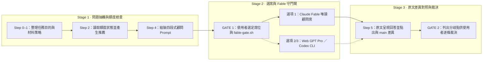

# `/advisor` — 跨模型單次顧問外包圖解

在不切換當前 session 主力模型的前提下，把單一架構取捨、方案盲審或卡關問題打包交給另一顆高階模型（Fable 顧問席、網頁版 GPT Pro 或 Codex CLI），只收回獨立意見與差異對照，不在本機留下任何檔案改動。完整規範見同目錄的 [`advisor.md`](/commands/advisor.md)。

## 運作流程圖

展開查看 Mermaid 結構原始碼（供 Agent／文字搜尋對照）

## 同目錄與隨附元件對照

| 檔案 | 角色 |
|---|---|
| [`/commands/advisor.md`](/commands/advisor.md) | Step 0–6 完整選席、四段式打包格式、收據核驗與裁決流程 |
| [`/agents/advisor-seat.md`](/agents/advisor-seat.md) | 選項 1 派出的唯讀顧問 subagent 定義檔 |
| [`/hooks/fable-gate.sh`](/hooks/fable-gate.sh) | 保護高單價 Fable 模型的 PreToolUse 守門 hook（驗證 `<fable-ok>` 標記與白名單角色） |
| [`/scripts/advisor-extract-context.py`](/scripts/advisor-extract-context.py) | 協助從 session 紀錄抽取顧問所需上下文的輔助腳本 |
| [`/config/gpt-models.env`](/config/gpt-models.env) | 外部 GPT 顧問與審查席位的模型名稱設定檔 |
