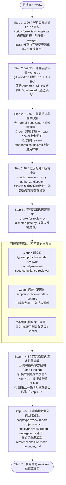

# `/pr-review` — 多軸對抗式 PR 審查與雙閘門圖解

把單一或多個 PR／分支範圍拉進隔離的 git worktree，依變更性質自動選出 Claude 側審查席位並提示可選的跨模型外部席，經授權 gate 放行後平行審查、交叉驗證、重錨行號，最後由報表投影腳本產出比較報告。完整規範見同目錄的 [`pr-review.md`](/commands/pr-review.md)。

## 運作流程圖

## 同目錄與隨附元件對照

| 檔案 | 角色 |
|---|---|
| [`/commands/pr-review.md`](/commands/pr-review.md) | Step 1–8 完整審查步驟、報告格式與錯誤處理 |
| [`/review-standards/catalog.md`](/review-standards/catalog.md) | 34 份審查標準的主目錄（必載底線、語言專屬規則、安全性與 AI 生成變更檢查） |
| [`/scripts/pr-review-targets.py`](/scripts/pr-review-targets.py) ／ [`/scripts/pr-review-profile.py`](/scripts/pr-review-profile.py) | 多目標輸入正規化、容量門檻計算與 repo 專屬規範讀取 |
| [`/scripts/pr-review-c4.py`](/scripts/pr-review-c4.py) ＋ [`/hooks/pr-review-c4-dispatch-gate.py`](/hooks/pr-review-c4-dispatch-gate.py) | 選席授權狀態機與攔截未授權 reviewer 派工的 PreToolUse hook |
| [`/scripts/pr-review-report-projection.py`](/scripts/pr-review-report-projection.py) ＋ [`/hooks/pr-review-report-write-gate.py`](/hooks/pr-review-report-write-gate.py) | 驗證各席狀態與覆蓋率後才放行寫入報告的投影腳本與寫入守門 hook |
| [`/scripts/pr-review-codex-set.mjs`](/scripts/pr-review-codex-set.mjs) ／ [`/scripts/pr-review-gemini-web.py`](/scripts/pr-review-gemini-web.py) | 外部跨模型審查席位的啟動、輪詢與收件腳本 |
