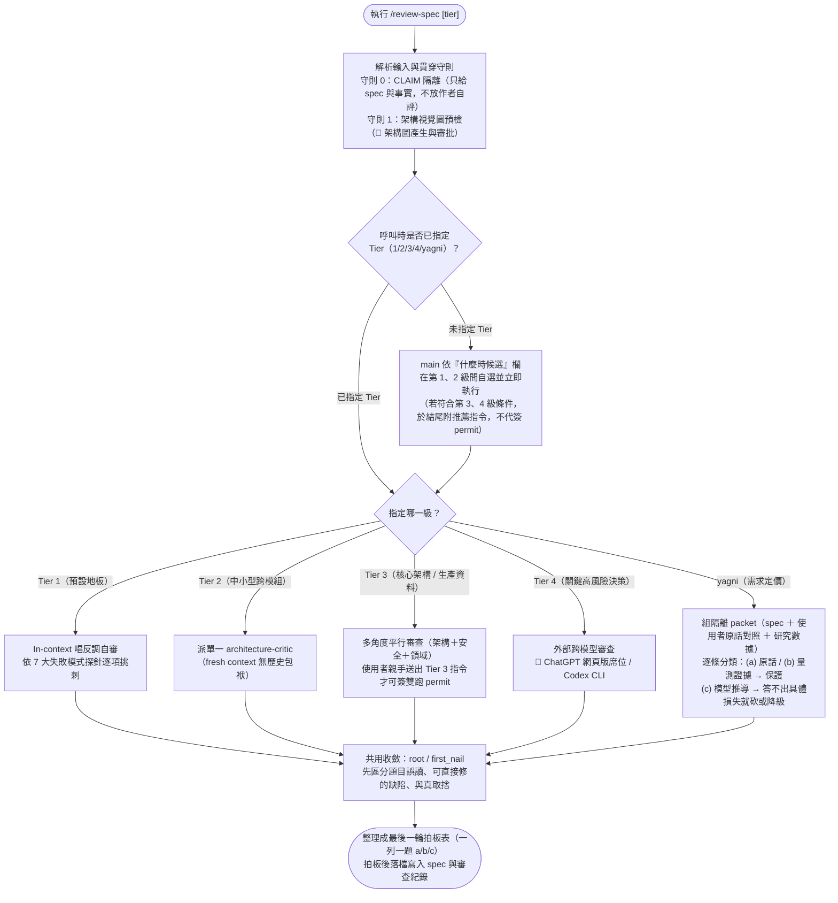

# `/review-spec` — 規格四級審查與 YAGNI 定價圖解

在規格（spec）進入拆票或實作前，依風險等級執行第 1–4 級對抗式審查與 YAGNI（砍除過度設計）需求定價，並強制隔離作者辯護理由、把所有爭議收斂到最後一輪一次拍板。完整規範見同目錄的 [`review-spec.md`](/commands/review-spec.md)。

## 運作流程圖

## 同目錄與隨附元件對照

| 檔案 | 角色 |
|---|---|
| [`/commands/review-spec.md`](/commands/review-spec.md) | Tier 1–4 與 YAGNI 軸完整流程、貫穿守則與呈現紀律 |
| [`/agents/architecture-critic.md`](/agents/architecture-critic.md) | Tier 2／Tier 3 派出的對抗式架構審查 subagent（套用 [`/review-standards/`](/review-standards/catalog.md) 架構鏡頭） |
| [`/references/failure-mode-taxonomy.md`](/references/failure-mode-taxonomy.md) | 審查時對照的 F1–F7 失敗模式探針表 |
| [`/hooks/review-spec-tier1-nudge.sh`](/hooks/review-spec-tier1-nudge.sh) | 偵測 spec 完成時提醒執行 `/review-spec` 的 hook |
| [`/commands/tests/review-spec-execution-contract.test.sh`](/commands/tests/review-spec-execution-contract.test.sh) | 驗證自選規則、Tier 3/4 授權邊界與 YAGNI packet 隔離的契約測試 |
