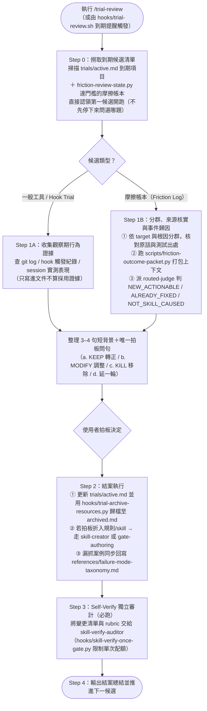

# `/trial-review` — 觀察期到期檢討與摩擦歸因圖解

統一盤點到期的工具／規則觀察期（trials）與累積達門檻的摩擦紀錄（friction logs），用真實觸發數據與事件歸因封包決定每項要「留（KEEP）、改（MODIFY）還是撤（KILL）」，落檔後經獨立審計才算結案。完整規範見同目錄的 [`trial-review.md`](/folder-level/.claude/commands/trial-review.md)。

## 運作流程圖

## 同目錄與隨附元件對照

| 檔案 | 角色 |
|---|---|
| [`/folder-level/.claude/commands/trial-review.md`](/folder-level/.claude/commands/trial-review.md) | Step 0–4 完整檢討、摩擦分群歸因、歸檔與 Self-Verify 規範 |
| [`/folder-level/.claude/hooks/trial-review.sh`](/folder-level/.claude/hooks/trial-review.sh) | Session 啟動時檢查到期 trial 與待審摩擦並發出提醒的 hook |
| [`/folder-level/.claude/hooks/trial-archive-resources.py`](/folder-level/.claude/hooks/trial-archive-resources.py) | 將結案項目搬移至 `archived.md` 並同步更新獨立索引 `archived.index.md` 的輔助程式 |
| [`/scripts/friction-outcome-packet.py`](/scripts/friction-outcome-packet.py) ／ [`/folder-level/.claude/hooks/friction-review-state.py`](/folder-level/.claude/hooks/friction-review-state.py) | 摩擦事件的 session 上下文安全打包器與待折門檻計數器 |
| [`/friction/PROTOCOL.md`](/friction/PROTOCOL.md) ／ [`/examples/trials/active.md`](/examples/trials/active.md) | 摩擦紀錄格式協議與觀察期帳本範例 |
