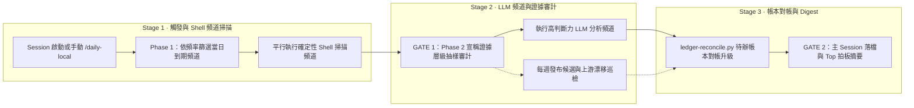

各種治理訊號（規則用量、摩擦、壞路徑、上游更新）散在不同地方，沒人會每天去看；daily-local 每天跑一次本機分析，彙整成一份報告。

入口是 `/daily-local` command（[`/commands/daily-local.md`](/commands/daily-local.md)）與 [`/hooks/daily-local-analysis-trigger.sh`](/hooks/daily-local-analysis-trigger.sh)；各 channel 的程式在 [`/social-info/scripts/local-analysis/`](/social-info/scripts/local-analysis/)，報告寫到 social-info 的 `reports/local-analysis/`。原作者的 repo 路徑寫死在 `local-analysis.js` 的 `SI` 常數與各 channel 腳本裡，換位置要一起改。

## 運作流程圖

展開查看 Mermaid 結構原始碼（供 Agent／文字搜尋對照）

## 核心隨附檔案

| 檔案 | 角色 |
|---|---|
| [`/workflows/local-analysis.js`](/workflows/local-analysis.js) | 30 個頻道的排程條件、模型路由與兩階段（`Scan` → `EvidenceBatchAudit`）編排腳本 |
| [`/commands/daily-local.md`](/commands/daily-local.md) ／ [`/hooks/daily-local-analysis-trigger.sh`](/hooks/daily-local-analysis-trigger.sh) | 手動與自動觸發入口、落檔後的帳本對帳與 Digest 合成規則 |
| [`/social-info/scripts/local-analysis/`](/social-info/scripts/local-analysis/) | 各頻道實作腳本（含 `recap-daily.sh`、`distill-weekly.sh`、`rules-size-weekly.sh`、`ledger-reconcile.py` 等） |
| [`/cc-skill-doctor/scripts/skill-doctor-weekly.sh`](/cc-skill-doctor/scripts/skill-doctor-weekly.sh) | 每週掃描 skill 健檢與觸發健康度的子頻道腳本 |
