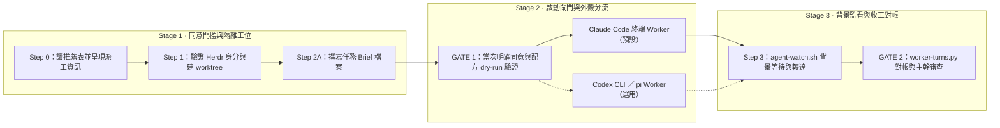

# `agent-dispatch` — 跨外殼終端 Worker 派工圖解

在獨立的 git worktree 與終端分頁（透過 Herdr）啟動完整的終端 worker（Claude Code、Codex CLI 或 pi），一次跑完一個 repo 的整包票，讓主 session 留在原目錄只負責派工、轉達、對帳與審查。完整規範見同目錄的 [`SKILL.md`](/skills/agent-dispatch/SKILL.md)。

## 運作流程圖

展開查看 Mermaid 結構原始碼（供 Agent／文字搜尋對照）

## 同目錄與隨附元件對照

| 檔案 | 角色 |
|---|---|
| [`SKILL.md`](/skills/agent-dispatch/SKILL.md) | Step 0–5 完整派工、等待、對帳與續接規範 |
| [`scripts/start-worker.sh`](/skills/agent-dispatch/scripts/start-worker.sh) | 驗證 Herdr 身分、依外殼（`claude`／`codex`／`pi`）開分頁、送出 brief、啟動背景監看並回傳 JSON 收據 |
| [`scripts/agent-watch.sh`](/skills/agent-dispatch/scripts/agent-watch.sh) | 背景等待 worker 進入 `idle`／`blocked`／`done`，只喚醒收據記載的 parent pane |
| [`scripts/worker-turns.py`](/skills/agent-dispatch/scripts/worker-turns.py) | 從指定 `session_id` 的紀錄檔分離 `[main]` 轉達與真人輸入，並取出最後交付訊息 |
| [`assets/brief-template.md`](/skills/agent-dispatch/assets/brief-template.md) | 交付給 worker 的任務 brief 範本（區分使用者原話與 main 判讀） |
| [`references/harness-recommendations.md`](/skills/agent-dispatch/references/harness-recommendations.md) | 模型 × 外殼推薦表骨架（供 Step 0 呈現同意訊息時參考） |
| [`references/herdr-notes.md`](/skills/agent-dispatch/references/herdr-notes.md) | Herdr 狀態語意、信任確認框與三種外殼續接細節筆記 |
