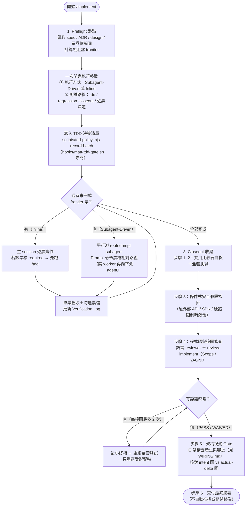

# `implement` — 票券執行與收尾控制流圖解

把已拆好的票券（tickets）按依賴順序逐批實作、強制對齊測試義務，並在收尾時完成跨軸審查與架構圖核對。完整規範見同目錄的 [`SKILL.md`](/skills/implement/SKILL.md)。

## 運作流程圖

## 同目錄與隨附元件對照

| 檔案 | 角色 |
|---|---|
| [`SKILL.md`](/skills/implement/SKILL.md) | 主流程定義（Preflight、Frontier 迴圈、Closeout 6 步） |
| [`scripts/tdd-policy.mjs`](/skills/implement/scripts/tdd-policy.mjs) | 產生與查詢批次測試決策清單（`manifest`），供 [`/hooks/matt-tdd-gate.sh`](/hooks/matt-tdd-gate.sh) 在改碼前攔截未宣告 TDD 義務的寫入 |
| [`references/regression-closeout.md`](/skills/implement/references/regression-closeout.md) | 選擇「實作後補回歸測試」路線時的收尾檢查清單 |
| [`/skills/review-implement/SKILL.md`](/skills/review-implement/SKILL.md) | Closeout 步驟 4 呼叫的 Scope／YAGNI 對抗式審查流程 |
| [`/WIRING.md#架構圖產生與審批`](/WIRING.md#架構圖產生與審批) | Closeout 步驟 5 的 🔌 接線點說明（預設推薦 Archify ＋ Plannotator） |
