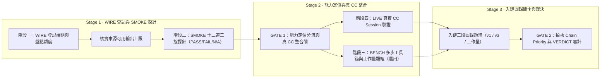

# `model-onboard` — 第三方模型接入與五階段評估圖解

把新的第三方模型接進本機模型池，並用五個獨立階段（接線、十二道探針、agentic 能力、真實 Claude Code 整合、回歸關卡與裁決）分離「接線漏層」「上游限流」「CC 整合退化」與「模型能力不足」，避免把環境或請求層故障誤判成模型不能用。完整規範見同目錄的 [`SKILL.md`](/skills/model-onboard/SKILL.md)。

## 運作流程圖

展開查看 Mermaid 結構原始碼（供 Agent／文字搜尋對照）

## 同目錄與隨附元件對照

| 檔案 | 角色 |
|---|---|
| [`SKILL.md`](/skills/model-onboard/SKILL.md) | 五階段主流程、入鏈關卡條件、自我檢查 rubric 與三個拍板停點 |
| [`references/wiring-layers.md`](/skills/model-onboard/references/wiring-layers.md) | 本機模型池接線層次地圖（含 🔌 [跨模型後端](/WIRING.md#跨模型後端) 接點） |
| [`references/bench-suite.md`](/skills/model-onboard/references/bench-suite.md) | 階段三多步工具鏈題組的跑法與判讀 |
| [`references/live-session.md`](/skills/model-onboard/references/live-session.md) | 階段四在真實 Claude Code session 內檢查整合層退化的步驟 |
| [`references/regress-gate.md`](/skills/model-onboard/references/regress-gate.md) | 排入日常備援鏈前的 v1／v3／真實工作量三段回歸題組規範 |
| [`references/traps.md`](/skills/model-onboard/references/traps.md) ／ [`LESSONS.md`](/skills/model-onboard/LESSONS.md) | 常見供應商限流、參數相容性與多輪工具簽章踩坑紀錄 |
| [`references/verdict-template.md`](/skills/model-onboard/references/verdict-template.md) | 最終裁決報告的固定表格模板 |
