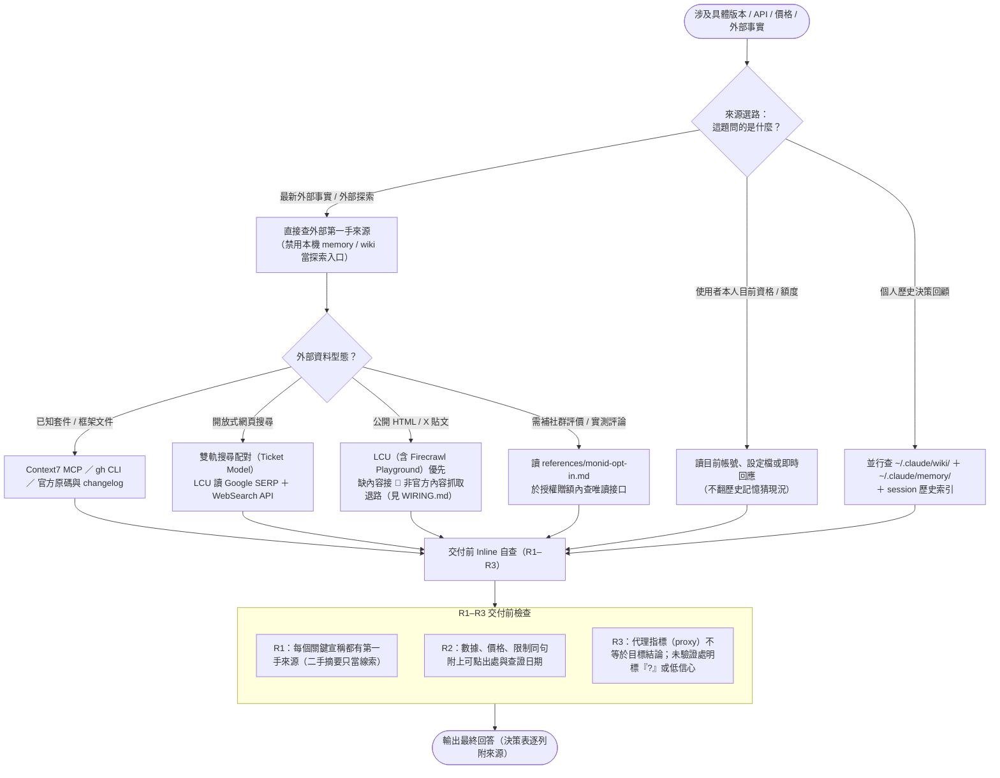

# `research-before-answer` — 回答前雙軌事實查證圖解

回答涉及具體套件、版本、API、價格、政策或最新外部動態的問題前，強制先分流題型、走第一手來源與雙軌搜尋，並在輸出前完成 R1–R3 自查，避免拿過時記憶或二手摘要當事實。完整規範見同目錄的 [`SKILL.md`](/skills/research-before-answer/SKILL.md)。

## 運作流程圖

## 同目錄與隨附元件對照

| 檔案 | 角色 |
|---|---|
| [`SKILL.md`](/skills/research-before-answer/SKILL.md) | 觸發條件、三路分流、雙軌搜尋、網頁抓取退路與 R1–R3 自查規則 |
| [`/rules/common/fact-check.md`](/rules/common/fact-check.md) | 與本 skill 配對的 17 條常駐事實查證紀律（本 skill 管流程、rule 管門檻） |
| [`references/monid-opt-in.md`](/skills/research-before-answer/references/monid-opt-in.md) | 補查社群評價與外部公開資料時的贈額查價與邊界規範 |
| [`evals/eval.yaml`](/skills/research-before-answer/evals/eval.yaml) ＋ [`evals/cases/`](/skills/research-before-answer/evals/cases/) | 16 個真實查證陷阱的評估題庫（版本幻覺、免費額度變更、代理指標誤判等） |
| [`scripts/tests/inline-verify-contract.test.sh`](/skills/research-before-answer/scripts/tests/inline-verify-contract.test.sh) | 鎖定 R1–R3 自查條款與決策表輸出格式的契約測試 |
