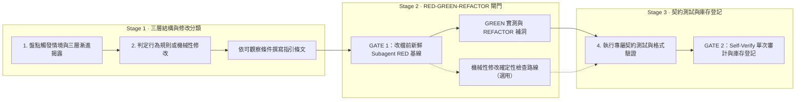

<!-- Modified from the original work at https://github.com/anthropics/skills/tree/main/skills/skill-creator (Apache-2.0, copyright Anthropic, PBC). See THIRD_PARTY_NOTICES.md. -->
# `skill-creator` — Skill 撰寫與對抗式行為驗證圖解

新建或修改任何 skill／command 時的單一規範來源（SSOT）：先做三層漸進揭露結構設計，再依編輯性質分流——行為規則變更必須走新鮮 subagent 的 `RED → GREEN → REFACTOR` 實測迴圈，機械性路徑或旗標同步則走確定性檢查。完整規範見同目錄的 [`SKILL.md`](/skills/skill-creator/SKILL.md)。

## 運作流程圖

展開查看 Mermaid 結構原始碼（供 Agent／文字搜尋對照）

## 同目錄與隨附元件對照

| 檔案 | 角色 |
|---|---|
| [`SKILL.md`](/skills/skill-creator/SKILL.md) | 漸進揭露設計原則、frontmatter 規範、RED/GREEN/REFACTOR 行為驗證與本地治理規則 |
| [`references/workflows.md`](/skills/skill-creator/references/workflows.md) | 多步驟工作流與條件分支的結構設計模式 |
| [`references/output-patterns.md`](/skills/skill-creator/references/output-patterns.md) | 輸出範本與品質標準的寫法範例 |
| [`scripts/init_skill.py`](/skills/skill-creator/scripts/init_skill.py) ／ [`scripts/quick_validate.py`](/skills/skill-creator/scripts/quick_validate.py) | 初始化 skill 目錄結構與驗證 frontmatter 格式的工具腳本 |
| [`scripts/tests/skill-authoring-contract.test.sh`](/skills/skill-creator/scripts/tests/skill-authoring-contract.test.sh) | 鎖定 RED 先於改檔、確定性檢查分流與外部指標句型的契約測試 |
| [`/hooks/skill-description-gate.sh`](/hooks/skill-description-gate.sh) ／ [`/hooks/skill-verify-once-gate.py`](/hooks/skill-verify-once-gate.py) | 攔截超長 description 與保護 Self-Verify 單次審計配額的機械 hook |
